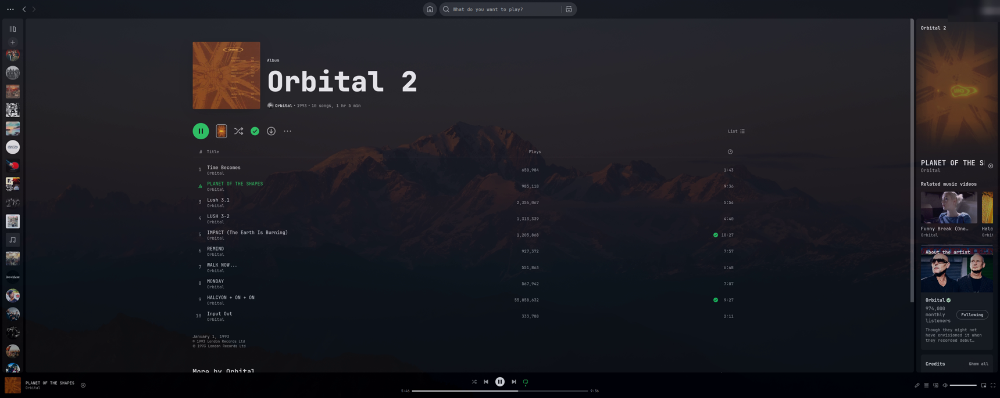
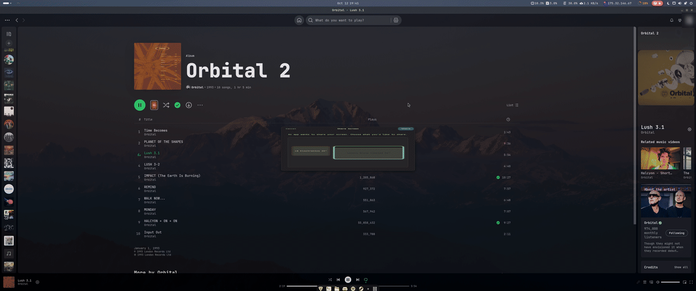

# Spotify Translucency

Makes the Spotify desktop app translucent, so your wallpaper shows through, and
removes the album-art colour tint so the whole window is one flat colour.





<sub>The screenshots also use a custom system font (JetBrainsMono), which
these scripts don't change.</sub>

It does two things:

1. **Flat colour**: patches Spotify's UI bundle (`Apps/xpui.spa`) with
   `spotify-translucency.css`. Spotify normally colours each page and panel
   from the album art; this resets that colour to the standard dark theme and
   removes the gradients and noise texture. A backup of the original is kept
   next to it (`xpui.spa.translucency-backup`).
2. **Translucent window**: Spotify's window can't be made see-through from
   inside the app, so this is done by the desktop:
   - **Windows**: a small hidden helper (starts at login) sets the window's opacity.
   - **Linux GNOME**: uses the *Blur my Shell* extension (only for Spotify).
   - **Linux KDE Plasma**: adds a KWin window rule.
   - **Other Linux desktops** (Hyprland, Sway, i3/picom…): the script prints the
     one line to add to your config.
   - **macOS**: no built-in way to do this, so you only get the flat colour.

Opacity is in percent: `100` = solid, lower = more see-through. The default is
`79`. Whatever you pass is saved, so later re-runs keep your setting.

Keep all the files together in one folder.

## Windows

Use the normal desktop Spotify from spotify.com. The Microsoft Store version
can't be modified.

- Double-click **`install-windows.cmd`**, or in PowerShell:

  ```powershell
  powershell -ExecutionPolicy Bypass -File .\install-windows.ps1 -Opacity 79
  ```

- Change opacity later: run it again with a new `-Opacity`. This takes effect
  within about 2 seconds, with no restart.
- Uninstall: double-click **`uninstall-windows.cmd`**, or run with `-Uninstall`.

Settings are saved in `%APPDATA%\SpotifyTranslucency\config.json`.

## Linux

```bash
chmod +x install.sh
./install.sh --opacity 79
```

- It will ask for your password (sudo) when Spotify is installed system-wide.
- **GNOME**: install the *Blur my Shell* extension first
  (https://extensions.gnome.org/extension/3193/blur-my-shell/ or
  `sudo apt install gnome-shell-extension-blur-my-shell`), log out and back in,
  then run the script. Your previous Blur my Shell settings are saved and put
  back on uninstall.
- Works with the .deb/apt, AUR/`spotify-launcher` and Flatpak versions. The
  **Snap** version is read-only and can't be patched, so install the .deb or
  Flatpak instead.
- Spotify in a non-standard location:
  `SPOTIFY_XPUI=/path/to/spotify/Apps/xpui.spa ./install.sh`
- Uninstall: `./install.sh --uninstall`

Settings are saved in `~/.config/spotify-translucency/config`.

## macOS

```bash
chmod +x install.sh
./install.sh
```

- If you get "Operation not permitted": open System Settings → Privacy &
  Security → **App Management**, allow Terminal, and run it again.
- If macOS then says Spotify is "damaged", run
  `codesign --force --deep --sign - /Applications/Spotify.app` once.
- Uninstall: `./install.sh --uninstall`

## After a Spotify update

Spotify updates replace the patched file, so the album-art tint comes back.
Just run the installer again. Your saved opacity is reused.

The stylesheet was built against Spotify **1.2.95**. Spotify sometimes renames
its internal CSS classes, so on a much newer version some gradients may
reappear until `spotify-translucency.css` is updated.

## Notes

- Opacity applies to the whole window, so text and album art become slightly
  translucent too, not only the background.
- The Windows helper was written against the Win32 API but hasn't been tested on
  a real Windows machine yet. If the window flickers or renders wrong, run the
  uninstaller.
